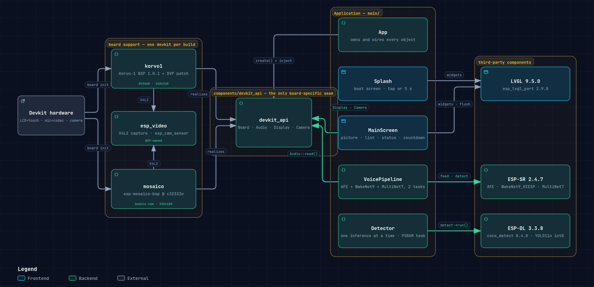

# TinyML Demo — ESP32-S31

Say **"Hi, ESP"**, then **"cheese"**, and the board takes a photo and shows you what
YOLO11n found in it — bounding boxes and labels on the LCD, all on-device, no cloud.

One application, two devkits: the **ESP32-S31-Korvo-1** (800×480) and the **ESP-Mosaico**
(480×480). The build preset picks the board; the application code is identical.



## What it does

- **Wake word** — WakeNet9 ("Hi, ESP") arms command mode
- **Command** — MultiNet7 listens for one of 33 registered phrases; only **"cheese"** takes a photo
- **Capture** — a still frame from the devkit's camera, converted once for the model and once for the screen
- **Detection** — YOLO11n 320×320 int8 through ESP-DL / `coco_detect`, ≈2.3 s on the Korvo-1 and ≈1.9 s on the ESP-Mosaico
- **Result** — the picture with its boxes, a named detection list beside it, and "tap to clear". The
  result stays until you tap or say "cheese" again — there is no auto-dismiss

## Run it in 60 seconds

Requires Docker and a devkit over USB. Nothing is installed on the host — the toolchain lives in
the container.

```bash
# 1. Build (inside the DevContainer, or in the same image by hand)
docker run --rm -it -v "$PWD":/project -w /project --name tinyml-demo-esp32s31 \
  espressif/idf:latest bash
source /opt/esp/idf/export.sh        # needed with `docker exec`; a plain `docker run -it` already has it
idf.py --preset korvo1 build         # or: --preset mosaico

# 2. Flash — app partition only; add the other offsets on a first flash (see docs/building.md)
esptool --chip esp32s31 -p /dev/ttyUSB0 -b 921600 \
  --before default-reset --after hard-reset \
  write-flash --flash-mode dio --flash-size 16MB --flash-freq 80m \
  0x10000 build/korvo1/tinyml-demo-esp32s31.bin

# 3. Talk to it
python3 -m serial.tools.miniterm /dev/ttyUSB0 115200
```

Say "Hi, ESP", then "cheese". The status line counts down, the picture box fills, and the
detections appear beside it.

## Supported devkits

| | ESP32-S31-Korvo-1 | ESP-Mosaico |
|---|---|---|
| Preset | `korvo1` | `mosaico` |
| Panel | 800×480 RGB LCD, GT1151 touch | 480×480 CO5300 QSPI panel, CST9217 touch |
| Camera | OV3660 over DVP, 240×240 RGB565_BE | left-slot camera module (OV3640 / SC101IOT), 320×180 |
| Audio codec | ES8389 | ES8311 |
| BSP | `espressif/esp32_s31_korvo_1` 1.0.1 | `esp-mosaico-bsp` @ `c32332e` |

Both: ESP32-S31, 16 MB flash, 16 MB octal PSRAM, target `esp32s31`. Both have two microphones;
the pipeline runs one channel.

## How it is built

`main/` holds the application: `App` owns and wires everything, `VoicePipeline` runs the two audio
tasks, `Detector` owns the inference task, `MainScreen` and `Splash` are the LVGL surfaces.
`components/devkit_api` is the board seam — `Board` / `Audio` / `Display` / `Camera` — and
`devkits/korvo1` and `devkits/mosaico` implement it. See
[docs/architecture](docs/architecture/README.md) for the interactive diagrams, the task table and
the regeneration command.

## Documents

- [docs/architecture](docs/architecture/README.md) — the two diagrams, what each shows, how to regenerate them
- [docs/building.md](docs/building.md) — how one app builds for two devkits, flashing, serial logs
- [docs/requirements.md](docs/requirements.md) — the SRS, with every acceptance criterion marked against the code

## References

**Shared**

- [ESP-IDF Programming Guide (6.2 development line)](https://docs.espressif.com/projects/esp-idf/en/latest/)
- [ESP-SR — WakeNet, MultiNet, AFE](https://github.com/espressif/esp-sr)
- [ESP-DL — on-device inference](https://github.com/espressif/esp-dl)
- [COCODetect component (`espressif/coco_detect`)](https://components.espressif.com/components/espressif/coco_detect)
- [esp_cam_sensor — the camera sensor layer both devkits use](https://components.espressif.com/components/espressif/esp_cam_sensor)
- [LVGL 9.5 documentation](https://docs.lvgl.io/9.5/)
- [ESP32-S31 datasheet](https://www.espressif.com/sites/default/files/documentation/esp32-s31_datasheet_en.pdf)

**ESP32-S31-Korvo-1**

- [Korvo-1 user guide](https://docs.espressif.com/projects/esp-dev-kits/en/latest/esp32s31/esp32-s31-korvo-1/user_guide.html)
- [Korvo-1 BSP — `espressif/esp32_s31_korvo_1`](https://components.espressif.com/components/espressif/esp32_s31_korvo_1)
- [Korvo-1 BSP source and examples (`esp-bsp`)](https://github.com/espressif/esp-bsp/tree/master/bsp/esp32_s31_korvo_1)
- [OV3660 sensor](https://www.ovt.com/products/ov3660) — DVP, RGB565_BE 240×240

**ESP-Mosaico**

- [ESP-Mosaico user guide](https://docs.espressif.com/projects/esp-dev-kits/en/latest/esp32s31/esp-mosaico/user_guide.html)
- [mosaico.espressif.com](https://mosaico.espressif.com/)
- [ESP-Mosaico BSP source](https://github.com/esp-mosaico/esp-mosaico-bsp) — `components/esp-mosaico-bsp` and `components/mosaico_module_camera`, both at the pinned commit
- Camera module: the left slot's module carries an OV3640 or SC101IOT sensor — see the user guide's camera section

## Licence

MIT — see [LICENSE](LICENSE).
