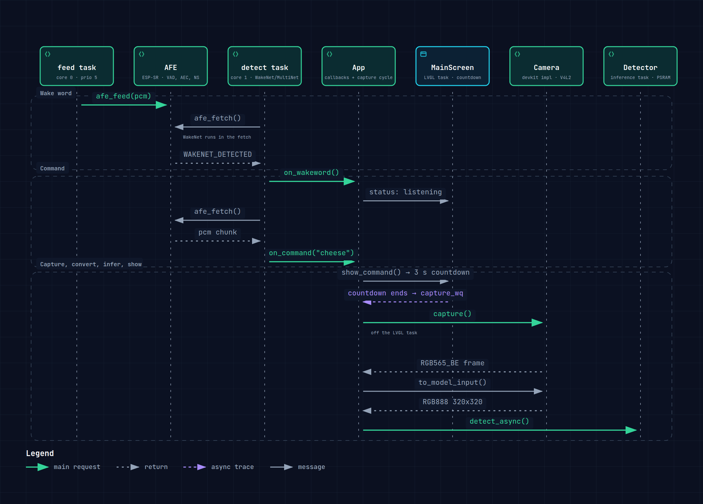

# TinyML Demo — ESP32-S31

Say **"Hi, ESP"**, then **"cheese"**, and the board takes a photo and shows you what
YOLO11n found in it — bounding boxes and labels on the LCD, all on-device, no cloud.

One application, two devkits: the **ESP32-S31-Korvo-1** (800×480) and the **ESP-Mosaico**
(480×480). The build preset picks the board; the application code is identical.


## Supported devkits

| | ESP32-S31-Korvo-1 | ESP-Mosaico |
|---|---|---|
| Preset | `korvo1` | `mosaico` |
| Panel | 800×480 RGB LCD, GT1151 touch | 480×480 CO5300 QSPI panel, CST9220 touch |
| Camera | OV3660 over DVP, 240×240 RGB565_BE | left-slot camera module (H2, OV3640 / SC101IOT), 320×180 |
| Audio codec | ES8389 | ES8311 |
| BSP | `espressif/esp32_s31_korvo_1` 1.0.1 | `esp-mosaico-bsp` @ `c32332e` |

Both: ESP32-S31, 16 MB flash, 16 MB octal PSRAM, target `esp32s31`. The ESP-Mosaico also carries a
1 Gbit SPI NAND for graphics and asset caching, which this app does not use. Audio input differs: the
Korvo-1 has a dual-microphone array, the ESP-Mosaico one onboard microphone
(LMA2718B331-OE1) into its ES8311. Either way the pipeline runs a single channel.


## What it does

- **Wake word** — WakeNet9 ("Hi, ESP") arms command mode
- **Command** — MultiNet7 listens for one of 33 registered phrases; only **"cheese"** takes a photo
- **Capture** — a still frame from the devkit's camera, converted once for the model and once for the screen
- **Detection** — YOLO11n 320×320 int8 through ESP-DL / `coco_detect`, ≈2.3 s on the Korvo-1 and ≈1.9 s on the ESP-Mosaico
- **Result** — the picture with its boxes, a named detection list beside it, and "tap to clear". The
  result stays until you tap or say "cheese" again — there is no auto-dismiss

## Run it in 60 seconds

Requires Docker and a devkit over USB. Nothing is installed on the host — the toolchain lives in
the container, and it needs the USB device passed through.

```bash
# 1. Build + flash, inside the container (ESP32-S31-Korvo-1)
docker run --rm -it -v "$PWD":/project -w /project --device=/dev/ttyUSB0 \
  espressif/idf:latest bash
idf.py --preset korvo1 -p /dev/ttyUSB0 flash

# 2. Watch it boot — Ctrl-] to exit
idf.py --preset korvo1 -p /dev/ttyUSB0 monitor
```

`idf.py flash` writes the whole set the build produced (bootloader, partition table, ota_data, the
ESP-SR models and the app) at the offsets in `build/<devkit>/flash_args`, and skips the partitions
that are already up to date. After a change to application code alone, `idf.py --preset <devkit>
-p /dev/ttyUSB0 app-flash` writes only the app partition.

`idf.py monitor` reads the console at the right baud rate and hands the ELF to the panic decoder, so
a crash prints a backtrace with function names instead of raw addresses.

A VS Code DevContainer does **not** forward USB devices by default — it needs `--device=/dev/ttyUSB0`
in its `runArgs` before flash or monitor can reach a devkit from inside it.

### ESP-Mosaico

The board cannot be treated like the Korvo-1: it has no auto-download circuit, and its console is not
on its USB port.

**1. Download mode.** Connect the Type-C cable, then hold **BOOT** while short-pressing **POWER**.
The screen stays black — that is download mode, and it is normal. The board has no auto-download
circuit, so `idf.py flash` cannot reset it into the bootloader by itself: every flash starts here.
Per the [vendor firmware-update guide](https://mosaico.espressif.com/firmware-update/), which also
offers a browser flasher for the stock firmware.

**2. Flash.** The board's own USB port is the one that enumerates as an Espressif ESP32-S31 in
download mode; check the number before flashing, because it is not always `ttyACM0`:

```bash
ls /dev/serial/by-id/     # usb-Espressif_ESP32-S31_… is the board; anything else is a bridge
idf.py --preset mosaico -p /dev/ttyACM0 flash
```

**3. Monitor — the console is UART0, so it needs a bridge.** This build's console is UART, not USB:
the left-slot camera module drives D2 on GPIO33, the pad USB Serial/JTAG uses
(`devkits/mosaico/sdkconfig.defaults`). The chip's own USB port serves download only, so watch the
console on the right-hand header H1 through a 3.3 V USB-UART bridge:

| Mosaico H1 | Signal | To the bridge |
|---|---|---|
| pin 15 | `TX0` (GPIO58) — console out | bridge **RX** |
| pin 13 | `RX0` (GPIO59) — console in | bridge **TX** |
| pin 20 | GND | GND |

Leave pins 17/18/19 (`5V_IN` / `5V_OUT` / `VCC_3V3`) alone — the Mosaico powers itself, and GND must
be common. If a capture returns nothing and the wiring looks right, swap RX and TX.

- **Raspberry Pi Pico 2** — what this project uses: GP1 to the Mosaico's `TX0`, GP0 to its `RX0`,
  GND to GND, with a small MicroPython UART-to-USB passthrough running on it. Plug the Pico into the
  host and treat it as the console port.
  If a capture returns 0 bytes while the port still enumerates, the Pico is wedged — power-cycle it.
  Its passthrough blocks mid-write when a burst arrives with nobody reading, and no amount of
  soft-resetting the bridge clears it.
- **Any 3.3 V USB-TTL adapter** — CP2102, FT232, CH340: the same three wires, no firmware needed,
  and the adapter's own `/dev/ttyUSB*` is the console port.

Having the firmware flashed, you can test it:  
Say "Hi, ESP", then "cheese". The status line counts down, the picture box fills, and the
detections appear beside it.


## How it is built

`main/` holds the application: `App` owns and wires everything, `VoicePipeline` runs the two audio
tasks, `Detector` owns the inference task, `MainScreen` and `Splash` are the LVGL surfaces.
`components/devkit_api` is the board seam — `Board` / `Audio` / `Display` / `Camera` — and
`devkits/korvo1` and `devkits/mosaico` implement it.

Both diagrams are generated from this repository and source-backed: every component carries
the file and line range that proves it. They are **generated files** — edit the JSON, never the HTML.

| Diagram | Interactive | What it answers |
|---|---|---|
| `architecture` | [architecture.html](https://htmlpreview.github.io/?https://github.com/ozanoner/tinyml-demo-esp32s31/blob/main/docs/architecture/architecture.html) | What the system is made of: the application layer, `components/devkit_api` as the only board seam, the two devkit implementations, `esp_video`, and the third-party stack |
| `runtime` | [runtime.html](https://htmlpreview.github.io/?https://github.com/ozanoner/tinyml-demo-esp32s31/blob/main/docs/architecture/runtime.html) | Where data crosses tasks: feed → AFE → detect → command → countdown → capture → conversions → inference → screen |

The runtime path, task by task:



## Documents

- [docs/building.md](docs/building.md) — how one app builds for two devkits, flashing, serial logs, regenerating the diagrams
- [docs/requirements.md](docs/requirements.md) — the SRS, with every acceptance criterion marked against the code

## References

**Shared**

- [ESP-IDF Programming Guide (6.2 development line)](https://docs.espressif.com/projects/esp-idf/en/latest/)
- [ESP-SR — WakeNet, MultiNet, AFE](https://github.com/espressif/esp-sr)
- [ESP-DL — on-device inference](https://github.com/espressif/esp-dl)
- [COCODetect component (`espressif/coco_detect`)](https://components.espressif.com/components/espressif/coco_detect)
- [esp_cam_sensor — the camera sensor layer both devkits use](https://components.espressif.com/components/espressif/esp_cam_sensor)
- [LVGL 9.5 documentation](https://docs.lvgl.io/9.5/)
- [ESP32-S31 datasheet](https://www.espressif.com/sites/default/files/documentation/esp32-s31_datasheet_en.pdf)

**ESP32-S31-Korvo-1**

- [Korvo-1 user guide](https://docs.espressif.com/projects/esp-dev-kits/en/latest/esp32s31/esp32-s31-korvo-1/user_guide.html)
- [Korvo-1 BSP — `espressif/esp32_s31_korvo_1`](https://components.espressif.com/components/espressif/esp32_s31_korvo_1)
- [Korvo-1 BSP source and examples (`esp-bsp`)](https://github.com/espressif/esp-bsp/tree/master/bsp/esp32_s31_korvo_1)
- [LCD subboard — ESP32-S3-LCD-EV-Board](https://docs.espressif.com/projects/esp-dev-kits/en/latest/esp32s3/esp32-s3-lcd-ev-board/user_guide.html) — the 4.3″ panel and touch the Korvo-1 is used with
- [OV3660 sensor](https://www.ovt.com/products/ov3660) — DVP, RGB565_BE 240×240

**ESP-Mosaico**

- [ESP-Mosaico user guide](https://docs.espressif.com/projects/esp-dev-kits/en/latest/esp32s31/esp-mosaico/user_guide.html)
- [Firmware update — download mode and the browser flasher](https://mosaico.espressif.com/firmware-update/)
- [mosaico.espressif.com](https://mosaico.espressif.com/)
- [ESP-Mosaico BSP source](https://github.com/esp-mosaico/esp-mosaico-bsp) — `components/esp-mosaico-bsp` and `components/mosaico_module_camera`, both at the pinned commit
- Camera module: the left slot (H2) takes the camera module, carrying an OV3640 or SC101IOT sensor — see the [camera module guide](https://docs.espressif.com/projects/esp-dev-kits/en/latest/esp32s31/esp-mosaico/user_guide_camera.html)

## Licence

MIT — see [LICENSE](LICENSE).
