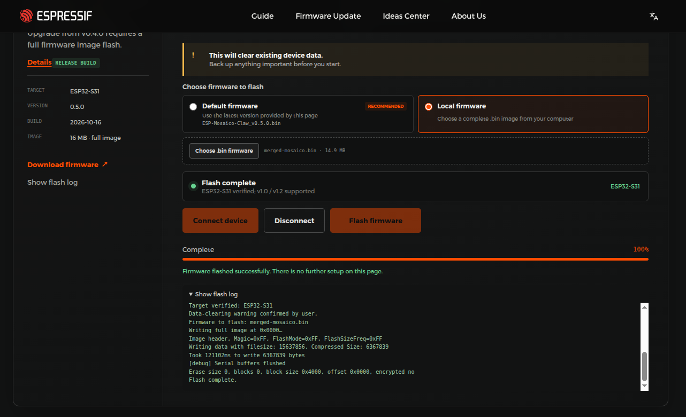

# Building, flashing and the two-devkit build

The README keeps the short path. This file keeps the detail that only matters when something
goes wrong or when you change how the build works.

## One app, two devkits

`CMakePresets.json` defines one preset per devkit. A preset carries everything the build needs, so
there is no `set-target` step and no `DEVKIT` variable to set by hand:

| Preset | Build directory | `sdkconfig` | `sdkconfig.defaults` |
|---|---|---|---|
| `korvo1` | `build/korvo1` | `build/korvo1/sdkconfig` | `sdkconfig.defaults` + `devkits/korvo1/sdkconfig.defaults` |
| `mosaico` | `build/mosaico` | `build/mosaico/sdkconfig` | `sdkconfig.defaults` + `devkits/mosaico/sdkconfig.defaults` |

Both presets set `IDF_TARGET=esp32s31` and `DEVKIT=<name>`.

The top-level `CMakeLists.txt` fails outright if `DEVKIT` is unset, checks that
`devkits/<DEVKIT>/idf_component.yml` exists, and then:

- puts **only the selected devkit's directory** in `EXTRA_COMPONENT_DIRS`
- names every *other* devkit in `EXCLUDE_COMPONENTS`

`main/CMakeLists.txt` requires `devkit_api` plus `$ENV{DEVKIT}` — unconditionally, from the
environment, never from a `CONFIG_*` value. That is deliberate: IDF evaluates component
CMakeLists twice, and the early-expansion pass runs before `sdkconfig` exists, so a
`CONFIG_`-conditional `REQUIRES` is recorded empty and the devkit never enters the requirement
graph — which shows up as `main/app_main.cpp includes bsp/esp-bsp.h … not in the requirements
list of "main"` and `lvgl.h: No such file or directory`.

**Why the other devkit is excluded rather than coexisting.** Both BSPs export the same symbols —
`bsp_display_new()`, `bsp_display_lock()`, `bsp_touch_new()` — so a build carrying both fails to
link. Excluding one also removes its manifest from the dependency solve, which is what lets each
devkit resolve its own version set (`esp_video` 2.2.0 + `esp_codec_dev` 1.5.x on the Korvo-1,
2.5.x + 1.6.x on the ESP-Mosaico) instead of one compromise version.

**The cost of switching.** Switching devkits re-solves the graph and prunes the other devkit's
components out of `managed_components/`, so they are fetched again on that devkit's next build.
Each devkit's build directory, object files and image survive the switch, and there is no
`set-target` and no full clean.

**There is no `sdkconfig` at the repository root — by design.** Each preset points at its own
`build/<devkit>/sdkconfig`. Nothing is lost by that file's absence.

## Dependency pins

Roots are pinned exactly; each pinned component's own manifest owns its subtree. Exact binary
reproduction of some earlier build is not a goal — these pins are today's resolve, not a promise.

`main/idf_component.yml`:

| Component | Pin | Why here |
|---|---|---|
| `espressif/esp-sr` | 2.4.7 | moves with `esp-dl` (below) |
| `espressif/esp-dl` | 3.3.8 | 3.3.13 strips ops at compile time to whatever registered req files name; only esp-sr registers one, so the `coco_detect` model's Swish op was compiled out, `Model::load()` failed and Detector init panicked on every boot (issue #27) |
| `espressif/coco_detect` | 0.4.0 | 0.4.1 declares `esp-dl ~3.3.13`; 0.4.0 and 0.4.1 ship identical sources and an identical model, only the declared range differs |
| `lvgl/lvgl` | 9.5.0 | `main/` includes `lvgl.h` directly, so the version is named here; it must sit in the intersection of `esp_lvgl_port` (`>=8,<10`) and the ESP-Mosaico BSP (`^9.5.0,<9.6.0`), where 9.5.0 is the only published version |

The BSP itself is owned by the selected devkit: `espressif/esp32_s31_korvo_1` 1.0.1 in
`devkits/korvo1/idf_component.yml`, and `esp-mosaico-bsp` + `mosaico_module_camera` pinned to
commit `c32332e9483edd10f0351ab0265f8b2ddb5992b1` in `devkits/mosaico/idf_component.yml`.

There is deliberately **no `overrides` block** in `main/idf_component.yml`. Two components would
need one if both devkits were solved together (`esp_video` and `esp_codec_dev`), but the excluded
devkit's manifest is never read, so each devkit gets its own set. Forcing one version across both
would hold the ESP-Mosaico camera module — the Mosaico's whole camera path — below the range it
declares.

`dependencies.lock` is **not** a pin and is not committed. The component manager writes it during
each build, so it records whichever devkit was solved last — the answer for one devkit, never a
project-wide graph. Building the other devkit rewrites it. The pins are the manifests named above.

## The Korvo-1 DVP patch, and why `idf.py --version` says `-dirty`

`devkits/korvo1/CMakeLists.txt` applies `devkits/korvo1/patches/esp-idf-dvp-frame-capture-stability.patch`
to `$ENV{IDF_PATH}` at configure time with `git apply --no-index`. It is idempotent (checked with
`--reverse --check` first) and it **warns and continues** if `git` is missing, the tree is
read-only, or the patch conflicts — in which case the build carries the stock driver.

Consequence: the IDF tree inside the image is modified, so the version string carries `-dirty`:

```
$ idf.py --version
ESP-IDF v6.1-dev-8440-gab95e70748f-dirty
```

and `git status` in the IDF tree shows exactly three files under
`components/esp_driver_cam/dvp/`. The ESP-Mosaico camera module ships the same patch for the same
driver and applies it from its own manifest.

## Build

Inside the DevContainer (`.devcontainer/devcontainer.json`, image `espressif/idf:latest`):

```bash
cd /project
idf.py --preset korvo1 build      # -> build/korvo1/tinyml-demo-esp32s31.bin
idf.py --preset mosaico build     # -> build/mosaico/tinyml-demo-esp32s31.bin
```

Without a DevContainer, in the same image by hand:

```bash
docker run --rm -it -v "$PWD":/project -w /project espressif/idf:latest bash
idf.py --preset korvo1 build
```

`docker exec` **does not** inherit the image entrypoint's environment, so a build driven that way
needs the export first — otherwise it fails with `idf.py: command not found`:

```bash
docker exec -it tinyml-demo-esp32s31 bash -c \
  'source /opt/esp/idf/export.sh && idf.py --preset korvo1 build'
```

After editing a `sdkconfig.defaults`, re-run `idf.py --preset <devkit> reconfigure` before
building: `sdkconfig` is authoritative and defaults only fill values it does not already have.

## Flash

Both devkits have **16 MB** flash. The layout is one CSV per devkit, `devkits/<devkit>/partitions.csv`,
and the two differ by a single line — the ESP-Mosaico adds a `coredump` partition:

```csv
# devkits/korvo1/partitions.csv — ESP32-S31 Korvo-1
# Name,   Type, SubType, Offset,  Size,     Flags
nvs,      data, nvs,     0x9000,  0x4000,
otadata,  data, ota,     0xd000,  0x2000,
phy_init, data, phy,     0xf000,  0x1000,
factory,  app,  factory, 0x10000, 8M,
model,    data, spiffs,  ,        4M,
coco_det, data, spiffs,  ,        3M,
```

```csv
# devkits/mosaico/partitions.csv — the same six rows, plus:
coredump, data, coredump, 0xF10000, 64K,
```

| Partition | Offset | Size | Holds | Which command writes it |
|---|---|---|---|---|
| `nvs` | `0x9000` | 16 KB | NVS key/value store — **unused by this app**: nothing calls `nvs_flash_init()` | — |
| `otadata` | `0xd000` | 8 KB | which slot to boot — always `factory` here, there are no OTA slots | full `flash` |
| `phy_init` | `0xf000` | 4 KB | RF calibration data | full `flash` / first boot |
| **`factory`** | `0x10000` | **8 MB** | **the application image** — 4.14 MB on the Korvo-1, 4.32 MB on the ESP-Mosaico (what fills it: below) | `app-flash` |
| **`model`** | `0x810000` | **4 MB** | **`srmodels.bin`** — the ESP-SR WakeNet/MultiNet models, 3.05 MB used, mounted as SPIFFS and read by `esp_srmodel_init("model")` | full `flash` |
| **`coco_det`** | `0xC10000` | **3 MB** | **the YOLO11n model** — `coco_detect.espdl`, 2,989,408 B, memory-mapped from this partition by ESP-DL's `fbs_loader` | full `flash` |
| `coredump` | `0xF10000` | 64 KB | panic dumps — ESP-Mosaico only | — |

**The detection model has a partition of its own.** `espressif/coco_detect` supports three
locations for the `.espdl` through a Kconfig choice (`model location`): linked into the app as
rodata, read from a flash partition, or read from an SD card. This project uses the partition, so
`libespressif__coco_detect.a` shrinks from 2.99 MB to **1.3 KB** — just the wrapper code — and the
model is written to `coco_det` by `idf.py flash`, which the component arranges itself through
`esptool_py_flash_to_partition`. The partition label `coco_det` is not ours to pick: it is
`coco_detect.cpp:8-9`, and the loader finds it with `esp_partition_find_first(DATA, SUBTYPE_ANY,
"coco_det")`. At boot it logs the sizes before mapping:

```
I (6731) FbsLoader: The storage free size is 61568 KB
I (6731) FbsLoader: The partition size is 3072 KB
```

**What fills the 4.14 MB app image** (Korvo-1, `idf.py --preset korvo1 size-components`): the ESP-DL
runtime that executes the model is the largest tenant at **2.02 MB, 49%**; ESP-SR's MultiNet G2P
grammar is 0.62 MB (15%); LVGL is 0.40 MB (10%); the rest is IDF, the C++ runtime and the
application. The model itself is no longer here — it is the `coco_det` partition above.

### What to flash, and when

| What changed | Command | Why |
|---|---|---|
| application code | `app-flash` | only `factory` differs — **34 s** for 4.1 MB |
| the detection model (a different `coco_detect` variant) | full `flash` | `coco_det` is written only by a full flash; `app-flash` does not touch it |
| `CONFIG_SR_*` (a different wake word or command model), or `partitions.csv` | full `flash` | `srmodels.bin` is a *new* file; a stale one left on the chip makes the board panic at boot while the model is parsed |
| the IDF version/toolchain, or anything that changes the bootloader | full `flash` | bootloader and app must come from the same build; an app-only flash on top of a changed bootloader boot-loops |
| a board that has never been flashed, or after `erase-flash` | full `flash` | there is nothing to preserve |
| nothing — you only want the console | `monitor` | |

**Why the two model partitions are usually skipped.** `idf.py flash` passes `--skip-flashed`, so it
compares each image with what is already on the chip and writes only what differs. Verified on the
Korvo-1 by re-running a full `esptool write-flash --skip-flashed` with all six images already in
place — every one was skipped, including the 3 MB `coco_det`:

```
'srmodels.bin'        at 0x00810000 already in flash, skipping write.
'coco_detect.espdl'   at 0x00c10000 already in flash, skipping write.
```

Raw `esptool write-flash` without the flag has no such check: it writes every image in the list,
every time. That is the practical reason to prefer `idf.py flash`, and to keep the `esptool` form
for machines that have no IDF.

Measured on the Korvo-1 over its CP2102N bridge at `-b 921600`: the app, 4,147,936 B in **34 s**;
`srmodels.bin`, 3,052,232 B in 43 s; `coco_detect.espdl`, 2,989,408 B in 40 s. For comparison, the
same application code with the model linked into it is 7,137,520 B and takes **74 s** — that 40 s is
what the partition saves on every app-only update. The ESP-Mosaico's USB-OTG path is slower: its
4,322,736 B app took **75 s**, where the old 7.3 MB image took 153 s.

**Preferred: let `idf.py` do it**, from inside the container with the devkit's USB port passed
through (`--device=/dev/ttyUSB0`, or in the DevContainer's `runArgs`):

```bash
idf.py --preset korvo1 -p /dev/ttyUSB0 flash       # the whole set the build produced
idf.py --preset korvo1 -p /dev/ttyUSB0 app-flash   # app partition only
idf.py --preset korvo1 -p /dev/ttyUSB0 monitor     # console + panic decoding
```

`flash` writes bootloader, partition table, `ota_data`, both model partitions and the app at the
offsets in `build/<devkit>/flash_args`. `app-flash` writes only `0x10000` — see
`build/<devkit>/flash_app_args`, which is one line.

**The same thing with `esptool` alone** — for a machine that has `esptool` but no IDF (a flash
runner, a CI box). These are the offsets `idf.py build` prints; the flags come from the same
`flash_args`:

```bash
# app only — the routine update
esptool --chip esp32s31 -p /dev/ttyUSB0 -b 921600 \
  --before default-reset --after hard-reset \
  write-flash --flash-mode dio --flash-size 16MB --flash-freq 80m \
  0x10000 build/korvo1/tinyml-demo-esp32s31.bin

# full set — new board, partition change, IDF/toolchain change, or any CONFIG_SR_* change
esptool --chip esp32s31 -p /dev/ttyUSB0 -b 921600 \
  --before default-reset --after hard-reset \
  write-flash --flash-mode dio --flash-size 16MB --flash-freq 80m \
  0x2000  build/korvo1/bootloader/bootloader.bin \
  0x8000  build/korvo1/partition_table/partition-table.bin \
  0xd000  build/korvo1/ota_data_initial.bin \
  0x810000 build/korvo1/srmodels/srmodels.bin \
  0xc10000 build/korvo1/espdl_models/coco_detect.espdl \
  0x10000 build/korvo1/tinyml-demo-esp32s31.bin
```

Leaving out both model images from that list is the `app-flash` case: correct as long as `model`
already holds the ESP-SR models the current `sdkconfig` selects and `coco_det` already holds the
detection model the current build packed.

### Flashing from a browser (ESP-Mosaico)

The one route that needs no host toolchain at all: the vendor's
[firmware-update page](https://mosaico.espressif.com/firmware-update/) talks to the board over Web
Serial and writes an image from the browser. It is Mosaico-only — the page is per-board, and the
Korvo-1 has no equivalent.

It writes a **full image at `0x0000`**, so the file it wants is the release's `merged-mosaico.bin`
(15,637,856 B) and not `app-mosaico.bin`, which belongs at `0x10000`. `merged-<devkit>.bin` is the
whole set in one image — bootloader, partition table, `ota_data`, both model partitions and the app —
which is exactly why the release publishes it.

Measured on this board: `Writing data with filesize: 15637856 … Took 121102ms`, i.e. about two
minutes, after the page verified the chip as `ESP32-S31 (v1.0 / v1.2 supported)`.

Worth knowing before using it:

- **It erases the board.** The page states "This will clear existing device data" and makes you
  confirm. NVS goes with it; nothing else here persists anything, so the cost is a re-flash of the
  models if you were on an older layout.
- **`Default firmware` on that page is the vendor image** (`ESP-Mosaico-Claw_v0.5.0.bin` at the time
  of writing), not this application. It is the way back to stock, and it is the fallback if a build
  ever leaves the board unresponsive while the ROM loader still answers.
- **Web Serial needs a Chromium desktop browser** over HTTPS (Chrome or Edge; Firefox and Safari do not
  implement it), and the board has to be in download mode if **Connect device** cannot find it — see
  the Mosaico steps in the README.



## Serial logs

```bash
python3 -m serial.tools.miniterm /dev/ttyUSB0 115200 | tee tinyml-demo_$(date +%Y%m%d_%H%M%S).log
```

Ctrl-] exits miniterm. Inside the container, `idf.py --preset <devkit> -p /dev/ttyUSB0 monitor` does
the same job and additionally hands the ELF to the panic decoder. The application logs:

- a banner with the devkit name, chip, SDK version, free SRAM and free PSRAM
- one memory summary line per bring-up stage (`I2C`, `AUDIO`, `DISPLAY+LVGL`, `CAMERA`, `DETECTOR`, `VOICE`)
- one `CVT:` line per capture with the geometry the camera path produced
- one `INF:` line per inference with its duration and detection count

The ESP-Mosaico's camera module claims the USB Serial/JTAG pads, so its console is UART-only and
has to be read through a UART bridge rather than a USB port.

## Releases

A tag is the release. `v*` starts the build workflow, which can also be started by hand from the
Actions tab:

| | On a tag | Manual run |
|---|---|---|
| `build` | checks that the diagrams are **stamped for this tag**, then builds both presets and attaches the images to the release | builds and uploads the images to the run summary; no stamp check, no release |

So a release takes **two commits**: the code, and a commit on top that refreshes the diagrams and
stamps them for the tag — pinned to the code commit it sits on, touching nothing except
`docs/architecture/`, and reviewed like any other change. The tag goes on the stamped commit.

Both commits have to live on the branch the tag is cut from. The pin names a commit, so a pin pointing
at something that only ever existed on a squash-merged feature branch is not in the released history,
and the check rejects it — which is the intended behaviour, and the reason the diagram refresh is a
commit on `main` after the merge rather than the last commit of a PR.

The stamp is one line at the end of each generated diagram page:

```
<!-- release: v0.1.0 @ 8c1d0f2… -->
```

The release refuses to build if a diagram is unstamped, stamped for a different tag, or if code has
moved since the stamped commit. The expensive half of the gate — re-resolving every cited
`path:line` and running the visual check — happens in the pre-release step, on the machine that
regenerates the diagrams, and is not repeated in CI: it would cost a Node toolchain and a browser
download to relearn something already proven.

### The reported version

The image reports the version it was built as: `app_init: App version:` in the boot log, and
`esp_app_get_description()->version`, which the splash screen prints. It comes from `version.txt` at
the project root, not from `git describe`.

`${IDF_PATH}/tools/cmake/project.cmake` tries five sources in order — the
`CONFIG_APP_PROJECT_VER_FROM_CONFIG` override, a `PROJECT_VER` variable, `version.txt`,
`project(... VERSION)`, `git describe` — and falls back to `"1"` when all of them fail
(documented at `docs/en/api-guides/build-system.rst:435-442`). `version.txt` is used because both
contexts this project builds in have no usable git metadata: a CI checkout is depth 1, so no tag
object is reachable, and the DevContainer runs as root over a mount owned by the host user, so git
refuses `/project` (`detected dubious ownership`) and `git describe` cannot run at all.

| Build | Version string |
|---|---|
| tag | `version.txt` as-is — `preflight` fails the release unless the file equals the tag |
| `workflow_dispatch` | `dispatch-g<short sha>` — the file would make it claim the last release, so the build passes `-DPROJECT_VER=…`, which wins over the file |
| local | whatever `version.txt` says, i.e. the last release |

The field is 31 characters: `esp_app_format/CMakeLists.txt` cuts the string
(`string(SUBSTRING … 0 31)` into `char version[32]`) silently, so an over-long version is truncated
rather than rejected.

Bump `version.txt` in the release's **code** commit. It cannot go in the stamping commit: the check
above rejects a release whose tree changed outside `docs/architecture/` after the stamp.

Two things are pinned so a release rebuilds what was tested: the toolchain image by digest
(`espressif/idf@sha256:6ad927cf…`, ESP-IDF v6.1-dev-8440), and the direct components through the
manifests — `main/idf_component.yml` plus the selected devkit's. Transitive components are whatever
those pinned components declare, and are not pinned themselves: a clean solve takes the newest
version that satisfies them. That is the accepted trade — the components that decide behaviour here
(the models, the detector, LVGL, both BSPs) are exact pins.

`merged-<devkit>.bin` is the whole flash set in one image — write it at `0x0` and the board is
complete, partitions and both models included (`esptool write-flash 0x0 merged-<devkit>.bin` with the
same `--flash-mode dio --flash-size 16MB --flash-freq 80m` flags).
